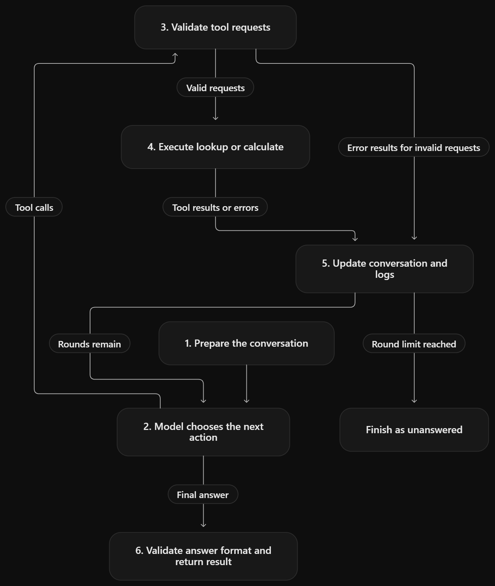

# HW4 — submission

**AI assistance:** <!-- what you used, and for what. "None" is an answer too. -->

---

## Part A — Plan on paper (Easy)

> Commit this whole part before any `.py` file exists.

### A1 — The steps

| # | Step                                                         | What goes in (types)                                                                                                                                                                                                  | What comes out (types)                                                                                                                                                                                                                                                                           | When it goes wrong                                                                                                                                                                                                                                                                                      | Tool, loop, or model?                                            |
|---|--------------------------------------------------------------|-----------------------------------------------------------------------------------------------------------------------------------------------------------------------------------------------------------------------|--------------------------------------------------------------------------------------------------------------------------------------------------------------------------------------------------------------------------------------------------------------------------------------------------|---------------------------------------------------------------------------------------------------------------------------------------------------------------------------------------------------------------------------------------------------------------------------------------------------------|------------------------------------------------------------------|
| 1 | **Receive the question and prepare the conversation**        | `question: str` — the user’s question; `system_prompt: str` — system instructions; `tool_definitions: list[dict]` — definitions of the available tools; `max_rounds: int` — the maximum number of calls to the model. | `messages: list[dict]` — the initial conversation containing the system message and the user’s question; initial loop state `dict`, including the round counter.                                                                                                                                 | If the question is empty, the input types are incorrect, or the round limit is invalid, the loop returns a clear error. No request is sent to the model.                                                                                                                                                | **Loop**                                                         |
| 2 | **Choose the next action**                                   | `messages: list[dict]` — the complete conversation history so far; `tool_definitions: list[dict]` — definitions of the available tools.                                                                               | `assistant_message: dict` — the model’s message containing tool requests in `tool_calls: list[dict]`, or a final answer in `content: str`. Tool requests lead to Step 3; a final answer leads to Step 6.                                                                                         | If the API call fails or the model returns an empty or invalid message, the loop records the error. The run is not considered successfully completed.                                                                                                                                                   | **Model**; the **loop** sends the request and handles API errors |
| 3 | **Validate the tool requests**                               | `tool_calls: list[dict]`. Each call contains an identifier `id: str`, a tool name `name: str`, and arguments `arguments: str` encoded as a JSON string.                                                               | Validated calls in `validated_calls: list[dict]`, with parsed arguments `arguments: dict`; invalid calls produce error results in `tool_errors: list[dict]`, linked to their original call identifiers.                                                                                          | An unknown tool name, malformed JSON, a missing required parameter, or an incorrect argument type produces an error for the corresponding call. Invalid calls are not executed.                                                                                                                         | **Loop**                                                         |
| 4 | **Execute the requested tool**                               | `name: str` — the tool name; `arguments: dict` — validated search parameters or an arithmetic expression.                                                                                                             | `result: dict`. For `lookup`, a limited set of facts or text fragments with source document IDs; numerical facts retain information about their units and year. For `calculate`, a numerical result of type `int` or `float`. If execution is not possible, the tool returns a structured error. | `lookup` returns an error if the requested information is missing, the query is ambiguous, or a value cannot be interpreted correctly. `calculate` returns an error for an invalid or prohibited expression, division by zero, or an exceeded computational limit. Tool errors must not crash the loop. | **Tool: `lookup` or `calculate`**                                |
| 5 | **Update the conversation and continue the loop**            | The original model message `assistant_message: dict`; tool results and errors in `tool_results: list[dict]`; the current loop state `dict`.                                                                           | Updated conversation history `messages: list[dict]`: the model’s message containing `tool_calls` is preserved unchanged, followed by a result for every `tool_call_id`. Arguments, results, and execution times are recorded in the log. If rounds remain, execution returns to Step 2.          | Tool errors are returned to the model with the corresponding call identifiers. The next model request is sent only after results have been added for every call. If the round limit is reached without a final answer, execution ends with status `unanswered`.                                         | **Loop**                                                         |
| 6 | **Validate the final answer’s format and return the result** | `answer_text: str` — the model’s final answer; accumulated execution information `dict`.                                                                                                                              | An execution result `dict` containing the answer `answer: str`, completion status `status: str`, and collected metrics `metrics: dict`. The answer is saved and returned to the user or the experiment runner.                                                                                   | If the required `ANSWER` line is missing or its fields cannot be parsed, a format error is recorded and the original response is saved. Factual correctness is checked separately against the reference answer after the solving process has finished.                                                  | **Loop**                                                         |

**How the steps connect:**

> The loop acts as the orchestrator, passing information between the model and the tools. Step 1 prepares the conversation, which is sent to the model in Step 2. If the model requests tools, the requests are validated in Step 3, and valid requests are executed in Step 4. Both successful results and error results are added to the conversation in Step 5, with one result for every tool call ID. If rounds remain, the updated conversation returns to Step 2, where the model chooses its next action. If the round limit is reached without a final answer, the run ends as unanswered. When the model produces a final answer, execution proceeds from Step 2 to Step 6, where the loop checks its format, saves it, and returns the result.



**What I am assuming:**

>1. Source of facts.
I use data/corpus.jsonl as the source of factual information about the districts. The current profiles, together with their correction notices, determine which values the system should use. Reference answers from questions.json are used only for evaluation after an answer has been produced.
>2. Years and reporting periods.
I use the year or period specified in the question. Unless stated otherwise, population figures refer to the 2025 census, budgets refer to the 2025 fiscal year, and household water use refers to the 2025 calendar year. Questions about population change require both the 2020 and 2025 census figures. School enrolment figures refer to the 2025/26 school year.
>3. Archived profiles.
Profiles marked ARCHIVED have been superseded and must not replace the current profiles when answering questions about current data. When a question requires the 2020 census population, I use the 2020 figure recorded in the current profile rather than an estimate from an archived profile.
>4. Corrections take precedence.
An explicit correction notice overrides the corresponding value in the original profile. Only the corrected field is replaced; the other figures remain unchanged. For example, Brightwater’s area must be taken as 921.4 km², as stated in NR-16, rather than the incorrect 912.4 km² in NR-05. The corrected fact should retain a reference to the correction notice.
>5. Units remain attached to values.
Retrieved numerical facts retain their units and relevant reporting period. I use compatible units in each formula and perform numerical conversions through calculate. In particular, 1 million tenge = 1,000,000 tenge, 1 megalitre = 1,000 cubic metres, and 1 cubic metre = 1,000 litres.
>6. Daily water consumption.
For questions about average household water use per resident per day in 2025, I divide annual household water use by the 2025 census population and 365 days. This uses the census population as the population denominator for the annual average.
>7. Rounding.
I do not deliberately round intermediate results. Derived quantities and differences are calculated using the available numerical precision. Only the final reported number is rounded to the number of decimal places specified for the question in its decimals field.
>8. Missing or ambiguous information.
If a required fact is missing, a district name is ambiguous, or a unit cannot be interpreted, the tool returns a clear error rather than guessing a value. The model may use that error to revise its request, within the loop’s round limit.

### A2 — The two tools

#### `lookup`

```json
{
  "type": "function",
  "function": {
    "name": "lookup",
    "description": "Search data/corpus.jsonl using BM25 over short original excerpts, without using reference answers. Query by district, indicator and period; regional and multi-district queries are allowed. Exclude archived profiles but retain historical figures in current sources. Return excerpts preserving values, periods and units, with doc_id, title, chunk_id, text, kind (profile/reference/correction) and correction_of (document ID or null). Include and deduplicate related correction excerpts; corrections override only the facts they explicitly change. Limits: top_k primary matches, 10 excerpts overall, 2 complete sentences and 500 text characters per excerpt, and 3000 text characters overall. Return an error if necessary correction context cannot fit. Return selected passages, not whole documents. The model interprets the evidence and requests more if needed; the tool does not calculate or answer the question.",
    "strict": false,
    "parameters": {
      "type": "object",
      "properties": {
        "query": {
          "type": "string",
          "minLength": 1,
          "maxLength": 300,
          "pattern": "\\S",
          "description": "Non-blank search text. Prefer English corpus terminology, e.g. Brightwater population 2025 area."
        },
        "top_k": {
          "type": "integer",
          "minimum": 1,
          "maximum": 5,
          "default": 3,
          "description": "Maximum primary matches. The tool defaults to 3. Additional corrections share the overall limits but do not count toward top_k."
        }
      },
      "required": ["query"],
      "additionalProperties": false
    }
  }
}
```

| Case                                     | What the tool returns                                                                                                                                                                            |
|------------------------------------------|--------------------------------------------------------------------------------------------------------------------------------------------------------------------------------------------------|
| success                                  | `ok: true`, `matches: array` of primary excerpts, `corrections: array` of additional correction excerpts, and `has_more: boolean`, indicating whether eligible candidates remain unreturned.     |
| no eligible matches                      | `{"ok":true,"matches":[],"corrections":[],"has_more":false}`. Archived sources are excluded; missing facts are not invented.                                                                     |
| invalid arguments                        | `{"ok":false,"error":{"code":"INVALID_ARGUMENTS","message":"..."}}`. The message identifies missing, blank, incorrectly typed, excessive or unexpected arguments. All errors use this structure. |
| detected district-name typo or ambiguity | `UNKNOWN_ENTITY` or `AMBIGUOUS_ENTITY`, with up to three names in `error.suggestions`. Exact names are never silently replaced.                                                                  |
| required context exceeds limits          | `CONTEXT_LIMIT_EXCEEDED`, asking for a narrower query or smaller `top_k`. Required corrections are never silently dropped.                                                                       |
| unavailable or invalid corpus/index      | `CORPUS_ERROR`, explaining the problem without fabricating results.                                                                                                                              |
| unexpected failure                       | `INTERNAL_ERROR`, with a short message and no internal paths or stack trace.                                                                                                                     |

**Worst thing it could do with strange or dangerous input:**

> Return evidence for the wrong district or period, or omit a correction, causing an incorrect answer. Input/output limits bound processing and context use. Queries are plain text against a fixed, read-only corpus; they cannot execute commands or open arbitrary files. Retrieved text is treated as data, not instructions.

#### `calculate`

```json
{
  "type": "function",
  "function": {
    "name": "calculate",
    "description": "Evaluate arithmetic or convert one numeric quantity. evaluate requires only mode and expression; convert requires mode, value, from_unit and to_unit, with optional scale. Reject fields belonging to the other mode. Arithmetic permits real numeric literals (including scientific notation), parentheses, unary +/- and +, -, *, /. Reject all other syntax. Use AST parsing and whitelisted evaluation, never eval or exec. Limits: 512 expression characters, 128 AST nodes, depth 16 (root depth 1), and finite inputs/intermediate results/results with absolute value <= 1e15. Check length before parsing. Conversion applies input scale first, then compatible unit conversion: 1 km=1000 m; 1 km2=1000000 m2; 1 ML=1000 m3; 1 m3=1000 L. Reverse conversions are supported. one is dimensionless; one, KZT, person, pupil and school each convert only to the same label. No compound units, currency exchange or calendar conversion. Normalise quantities separately before calculating ratios. Return finite floating-point results without extra intermediate rounding; evaluate does not check units or the meaning of a formula.",
    "strict": false,
    "parameters": {
      "type": "object",
      "properties": {
        "mode": {
          "type": "string",
          "enum": ["evaluate", "convert"]
        },
        "expression": {
          "type": "string",
          "minLength": 1,
          "maxLength": 512,
          "description": "Required only for evaluate. Non-blank expression; use decimal points and no thousands separators."
        },
        "value": {
          "type": "number",
          "minimum": -1e15,
          "maximum": 1e15,
          "description": "Required only for convert. Numeric quantity before scaling; booleans are invalid."
        },
        "scale": {
          "type": "string",
          "enum": ["one", "thousand", "million"],
          "default": "one",
          "description": "Optional only for convert. Input multiplier: 1, 1000 or 1000000. The tool defaults to one; output uses ordinary target units."
        },
        "from_unit": {
          "type": "string",
          "enum": ["one", "KZT", "person", "pupil", "school", "m", "km", "m2", "km2", "L", "m3", "ML"],
          "description": "Required only for convert. Case-sensitive source unit."
        },
        "to_unit": {
          "type": "string",
          "enum": ["one", "KZT", "person", "pupil", "school", "m", "km", "m2", "km2", "L", "m3", "ML"],
          "description": "Required only for convert. Compatible, case-sensitive target unit."
        }
      },
      "required": ["mode"],
      "additionalProperties": false
    }
  }
}
```

| Case                                       | What the tool returns                                                                                                                                                                                                             |
|--------------------------------------------|-----------------------------------------------------------------------------------------------------------------------------------------------------------------------------------------------------------------------------------|
| success: arithmetic                        | `{"ok":true,"mode":"evaluate","value":50,"unit":null}` for `(100 + 50) / 3`. `unit: null` means units were not checked.                                                                                                           |
| success: scaling                           | `{"ok":true,"mode":"convert","value":1000000,"unit":"KZT"}` for `value: 1`, `scale: "million"`, and both units `"KZT"`.                                                                                                           |
| success: unit conversion                   | `{"ok":true,"mode":"convert","value":2500,"unit":"m3"}` for `2.5 ML` converted to `m3`.                                                                                                                                           |
| invalid arguments                          | `{"ok":false,"error":{"code":"INVALID_ARGUMENTS","message":"..."}}`. Covers missing mode-specific fields, wrong types, blank expressions, invalid mode/scale, and unexpected or wrong-mode fields. All errors use this structure. |
| malformed expression                       | `INVALID_EXPRESSION`, identifying a syntax problem such as unmatched parentheses.                                                                                                                                                 |
| forbidden expression                       | `UNSUPPORTED_EXPRESSION`. Rejects names, calls, attributes, containers, booleans, complex numbers and unsupported operators, including `__import__('os').system('echo hi')`, `(1).__class__` and `9**9**9`.                       |
| division by zero                           | `DIVISION_BY_ZERO`; no numeric result is returned.                                                                                                                                                                                |
| size, complexity or numeric limit exceeded | `LIMIT_EXCEEDED`, identifying the exceeded limit. Includes non-finite values and excessive values after scaling or conversion.                                                                                                    |
| unknown or compound unit                   | `UNSUPPORTED_UNIT`, identifying the unsupported label.                                                                                                                                                                            |
| incompatible units                         | `INCOMPATIBLE_UNITS`, e.g. `m3` to `KZT` or `school` to `person`.                                                                                                                                                                 |
| unexpected failure                         | `INTERNAL_ERROR`, with a short message and no stack trace.                                                                                                                                                                        |

**Worst thing it could do with strange or dangerous input:**

> An implementation bug could allow code execution or resource exhaustion. AST whitelisting, the prohibition of eval/exec, and input, complexity and numeric limits address these risks. Valid but incorrectly specified formulas or units can still produce misleading results, and floating-point precision can affect the last digits. Final rounding follows the question’s requirements.

### A3 — Q-09 by hand

```json
[
  {
    "role": "user",
    "content": "Which district has the higher population density in 2025, Brightwater or Millbrook, and by how many residents per square kilometre?"
  },
  {
    "role": "assistant",
    "content": null,
    "tool_calls": [
      {
        "id": "call_lookup_brightwater",
        "type": "function",
        "function": {
          "name": "lookup",
          "arguments": "{\"query\":\"Brightwater population 2025 area\",\"top_k\":1}"
        }
      },
      {
        "id": "call_lookup_millbrook",
        "type": "function",
        "function": {
          "name": "lookup",
          "arguments": "{\"query\":\"Millbrook population 2025 area\",\"top_k\":1}"
        }
      }
    ]
  },
  {
    "role": "tool",
    "tool_call_id": "call_lookup_brightwater",
    "content": "{\"ok\":true,\"matches\":[{\"doc_id\":\"NR-05\",\"title\":\"Brightwater district profile (2025)\",\"chunk_id\":\"NR-05:s2-3\",\"text\":\"The district, founded in 1889, stretches along the Bright over 912.4 square kilometres and keeps 455.0 km of paved road. Census population: 39,902 in 2020 and 44,675 in 2025.\",\"kind\":\"profile\",\"correction_of\":null}],\"corrections\":[{\"doc_id\":\"NR-16\",\"title\":\"Correction notice - Brightwater\",\"chunk_id\":\"NR-16:s3-4\",\"text\":\"The correct area is 921.4 square kilometres. All other figures in that profile are correct.\",\"kind\":\"correction\",\"correction_of\":\"NR-05\"}],\"has_more\":true}"
  },
  {
    "role": "tool",
    "tool_call_id": "call_lookup_millbrook",
    "content": "{\"ok\":true,\"matches\":[{\"doc_id\":\"NR-11\",\"title\":\"Millbrook district profile (2025)\",\"chunk_id\":\"NR-11:s2-3\",\"text\":\"The district, founded in 1897, stretches along the Mill Brook over 758.6 square kilometres and keeps 360.1 km of paved road. Census population: 34,590 in 2020 and 37,203 in 2025.\",\"kind\":\"profile\",\"correction_of\":null}],\"corrections\":[],\"has_more\":true}"
  },
  {
    "role": "assistant",
    "content": null,
    "tool_calls": [
      {
        "id": "call_calculate_difference",
        "type": "function",
        "function": {
          "name": "calculate",
          "arguments": "{\"mode\":\"evaluate\",\"expression\":\"37203 / 758.6 - 44675 / 921.4\"}"
        }
      }
    ]
  },
  {
    "role": "tool",
    "tool_call_id": "call_calculate_difference",
    "content": "{\"ok\":true,\"mode\":\"evaluate\",\"value\":0.5556561156405735,\"unit\":null}"
  },
  {
    "role": "assistant",
    "content": "ANSWER: Millbrook | 0.6"
  }
]
```

**My arithmetic:**
Population density is population divided by area. NR-16 corrects Brightwater’s area from **912.4 to 921.4 km²**; its population remains unchanged. Millbrook’s figures come from NR-11.

$$
\rho_{\text{Brightwater}}
=\frac{44675}{921.4}
\approx 48.4859995659\text{ residents/km}^2
$$

$$
\rho_{\text{Millbrook}}
=\frac{37203}{758.6}
\approx 49.0416556815\text{ residents/km}^2
$$

Using the original fractions, without rounding intermediate values:

$$
\Delta
=\frac{37203}{758.6}-\frac{44675}{921.4}
=\frac{9709730}{17474351}
\approx 0.5556561156\text{ residents/km}^2
$$

The difference is positive, so **Millbrook** has the higher density. Rounded to one decimal place, the difference is **0.6 residents/km²**.
### A4 — Why I split it this way

> An alternative would be one solve_question tool that retrieves documents, selects facts, performs calculations and returns the final answer. This would simplify the loop’s external interface. I chose separate lookup and calculate tools so that retrieval and arithmetic can be tested independently, their outputs inspected, and failures traced to a specific step. The model interprets the question and evidence and chooses the formula; lookup provides source excerpts; calculate performs bounded numerical operations; and the loop validates calls and passes results between components.
---

## Part B — Build it and run it (Medium)

### What I changed from Part A while coding

<!-- what changed in your plan, and why. "None" is an answer too. -->

### B2 — Tests

```text
<!-- pytest output -->
```

### B3 — The loop

- Round limit, and why:
- Where the logs are:
- Real Q-09 conversation compared with my A3 version, what is different:

### B4 — Three strategies

**What I kept the same:**

<!-- model, temperature, k, prompts, answer format, anything else -->

**My rule for a correct answer** (written before the first full run):

| Run | Strategy | Correct /20 | Unanswered | Input tokens | Output tokens | Median seconds per question | Total seconds | Cost ($) |
|---|---|---:|---:|---:|---:|---:|---:|---:|
| 1 | S1 direct | | | | | | | |
| 1 | S2 think and vote (k = ) | | | | | | | |
| 1 | S3 tools | | | | | | | |
| 2 | S1 direct | | | | | | | |
| 2 | S2 think and vote (k = ) | | | | | | | |
| 2 | S3 tools | | | | | | | |

**Per question (run 1):**

| Question | S1 | S2 | S3 |
|---|:---:|:---:|:---:|
| Q-01 | | | |
| Q-02 | | | |
| Q-03 | | | |
| Q-04 | | | |
| Q-05 | | | |
| Q-06 | | | |
| Q-07 | | | |
| Q-08 | | | |
| Q-09 | | | |
| Q-10 | | | |
| Q-11 | | | |
| Q-12 | | | |
| Q-13 | | | |
| Q-14 | | | |
| Q-15 | | | |
| Q-16 | | | |
| Q-17 | | | |
| Q-18 | | | |
| Q-19 | | | |
| Q-20 | | | |

---

## Part C — Explain and choose (Hard)

### C1 — Does the tool description matter?

| Question | Calls (your description) | Calls (vague) | Answer (yours) | Answer (vague) |
|---|---:|---:|---|---|
| | | | | |

### C2 — Three mistakes explained

### C3 — Which strategy I would use, and what would change it

### C4 — How sure I can be

### Final questions

1.
2.
3.
4.
5.
6.
7.
8.
